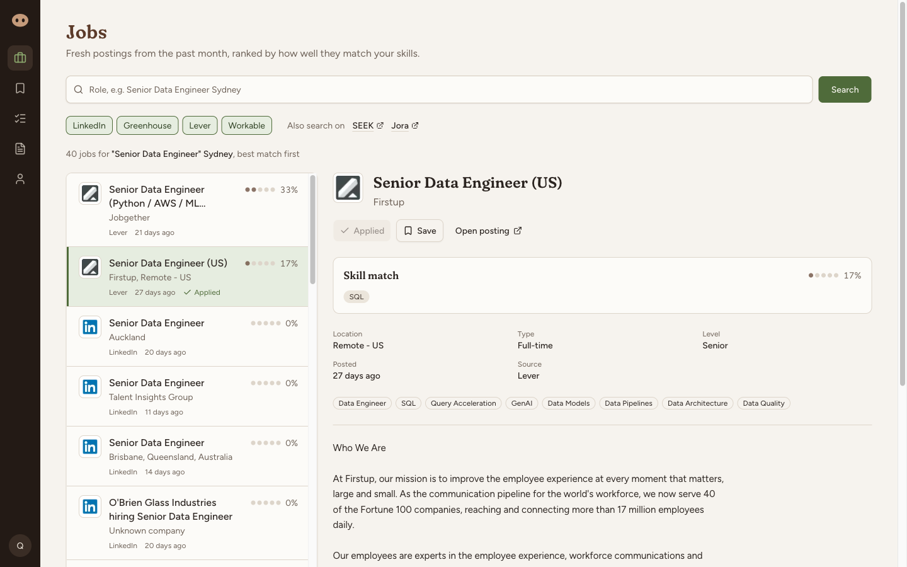
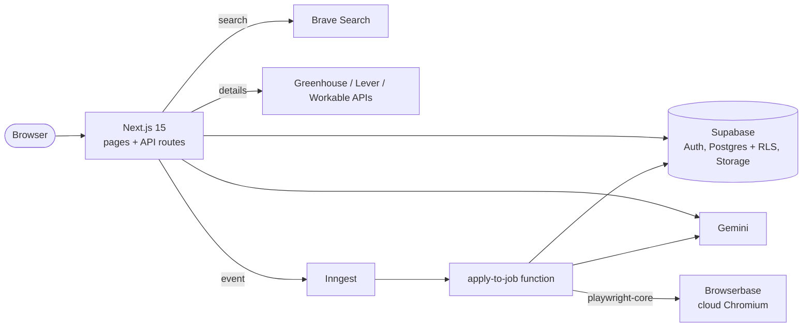
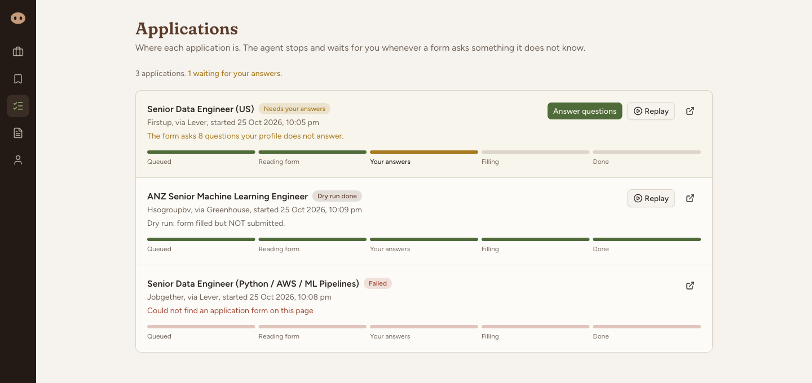
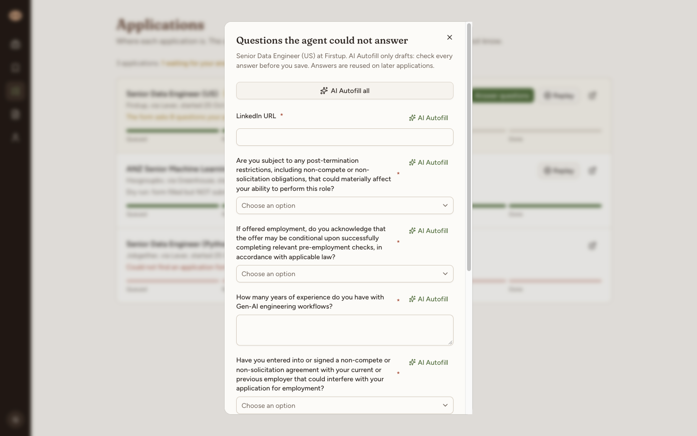
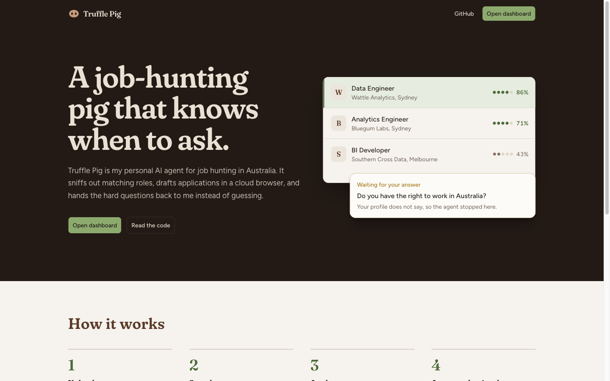
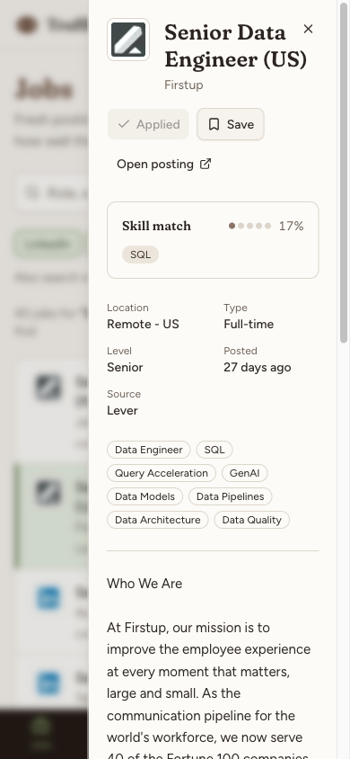

<p align="center">
  
</p>

<h1 align="center">Truffle Pig</h1>

<p align="center">
  A personal, human-in-the-loop AI agent for job hunting in Australia.
</p>

<p align="center">
  <a href="https://github.com/fatcat0401/truffle-pig/actions/workflows/ci.yml"></a>
  
  
  <a href="LICENSE"></a>
</p>



Truffle Pig finds fresh Australian job postings, ranks them against my resume, and fills in application forms
in a cloud browser. When a form asks something my profile cannot answer, it stops and asks me instead of
guessing. It runs on my laptop, for me only.

## Why I built it

Job hunting in Australia means checking SEEK, LinkedIn and dozens of company careers pages, then typing the same
details into form after form. I followed a course that builds an "AI job application SaaS", then rebuilt it for
the Australian market and for how I actually want to apply: fewer, better applications, with me reviewing every
answer.

## Features

- **Resume to profile.** Upload a PDF or DOCX; Gemini extracts skills, experience, projects and certifications.
- **Australian job search.** LinkedIn, Greenhouse, Lever and Workable postings from the past month, in your city,
  ranked by skill match. SEEK and Jora open as pre-filled searches.
- **Job details without scraping.** Salary, type, level and the full description come from the careers sites'
  public APIs.
- **Apply robot.** Detects the form, fills what the profile covers, uploads the resume, and records a replay.
- **Questions come back to you.** Unknown required fields stop the run; answer them once and they are reused.
- **Dry run by default.** The robot fills the form but does not press Submit unless you turn that on.

## Architecture



More detail: [architecture](docs/architecture.md), [the apply robot](docs/robot-pipeline.md) and
[design decisions](docs/decisions.md).

## Tech stack

| Layer | Tool | Why |
|---|---|---|
| App | Next.js 15 (App Router), React 19, TypeScript | Pages and API routes in one project; server-only modules keep keys off the client |
| UI | Tailwind CSS v4, shadcn/ui (Radix) | Accessible primitives, themed with my own tokens |
| Data | Supabase: Postgres, Auth (Google), Storage | Row Level Security per user, private resume bucket, one hosted service |
| AI | Gemini (`@google/genai`), `gemini-3.5-flash-lite` | Structured JSON output; picked after timing models (see decisions) |
| Search | Brave Search API | Official search API with `country` and `freshness` filters |
| Background jobs | Inngest | Steps, retries and concurrency limits for a run that takes minutes |
| Browser | Browserbase, `playwright-core`, Stagehand (fallback) | Cloud Chromium with session replay; plain Playwright first, AI only for failed fields |
| Validation | Zod v4 | Every API body is parsed before use |
| Tests | Vitest, GitHub Actions | Unit tests for the parsing and ranking logic; lint, typecheck, test and build on every push |

## Engineering highlights

- **Public ATS APIs instead of a paid scraper.** Details come from Greenhouse, Lever and Workable's keyless JSON
  APIs, and a 404 becomes "job closed" (HTTP 410). See [`lib/job-details.ts`](lib/job-details.ts).
- **Detect, map, fill.** The robot reads the whole form once, decides every value in one place, then fills it with
  plain Playwright. Stagehand's AI only retries fields that failed. See [`lib/apply/`](lib/apply).
- **It learns form labels.** When Gemini maps a label to a profile fact, `(platform, label) -> fact` is stored in
  `field_label_maps`, so the same label never needs a model call again. See [`lib/apply/map.ts`](lib/apply/map.ts).
- **Search that works for Australia.** `"Giralang ACT 2617"` made Brave return jobs from other countries;
  `buildSearchPlace` turns it into `"Canberra"`. The role is quoted and LinkedIn's identical advert snippet is
  dropped so it does not inflate match scores. See [`lib/jobs.ts`](lib/jobs.ts) and [`lib/brave.ts`](lib/brave.ts).
- **Measured, then fixed, a slow model.** `gemini-3.8-flash` took over 30 s (once 152 s). I timed alternatives,
  switched to `gemini-3.5-flash-lite` (about 2 s) and added a 15 s timeout so Details never hangs.
- **Locked down for one user.** `ALLOWED_EMAILS` is checked in the OAuth callback, middleware and every API route,
  failing closed; Postgres RLS keeps each user's rows private. See [`lib/allowed-emails.ts`](lib/allowed-emails.ts).

## Screenshots

| Applications | A form question the agent could not answer |
|---|---|
|  |  |

| Landing page | Phone |
|---|---|
|  |  |

All screenshots use a fictional test profile ([sample resume](docs/sample/quangtran-tester-cv.pdf)). The jobs are
real public postings at the time of capture.

## Limitations and responsible use

- **Careers pages only.** The robot applies on Greenhouse, Lever and Workable. LinkedIn is read-only; SEEK and Jora
  are links. Nothing logs in as you anywhere.
- **Dry run by default** (`APPLY_DRY_RUN=true`). Turn it off only if you review every application.
- **It does not invent answers.** Unknown required questions stop the run. AI Autofill only drafts answers in the
  dialog and is told not to claim experience you do not have, but it is a language model: read every draft.
- **Overseas jobs still appear.** `country=AU` biases Brave but does not filter; Greenhouse, Lever and Workable are
  global.
- **Parsing is heuristic.** LinkedIn titles sometimes put a place in the company field, and company names from
  careers-page URLs can look odd ("Hsogroupbv").
- **Custom dropdowns.** New Greenhouse boards use React selects that the robot reads as text boxes; it types the
  answer and falls back to Stagehand.

## What I learned

- Reading a site's public API beats scraping it: faster, free, and it tells you when a job is closed.
- Put slow, flaky work (browsers, models) behind a queue with explicit statuses; the UI then just shows the state.
- Measure model latency before blaming the network. The "smarter" model was the slow part.
- An agent is most useful when it knows where to stop. Designing the `missing_info` path mattered more than the
  filling code.

## Run locally

Needs Node 22+, a Supabase project, and API keys for Gemini, Brave Search and Browserbase.

1. `npm ci`, then copy [`.env.example`](.env.example) to `.env.local` and fill it in. Put your Google email in
   `ALLOWED_EMAILS`.
2. Run [`supabase/schema.sql`](supabase/schema.sql) in the Supabase SQL editor, then the files in
   `supabase/migrations/`. The schema starts with a dev-only reset block: never run it on data you want to keep.
3. Enable the Google provider in Supabase Auth.
4. Start two terminals:

   ```bash
   npm run dev
   npx inngest-cli@latest dev -u http://localhost:3000/api/inngest
   ```

5. Open http://localhost:3000. `npm test` runs the unit tests.

## Credits

Started from the YouTube course "Build Full Stack AI Job Application Agent SaaS App with Next.js, React & Cursor".
Built beyond it: the Australian job sources and search tuning, public ATS APIs instead of Firecrawl, the Gemini
benchmark and timeout, the Stagehand fallback and label learning, the single-user lock, the new design, the
fixes found while testing (a stuck spinner, a Turbopack bundling error with Stagehand, Lever question labels,
over-confident autofill drafts), and the tests and CI.

## License

[MIT](LICENSE)
