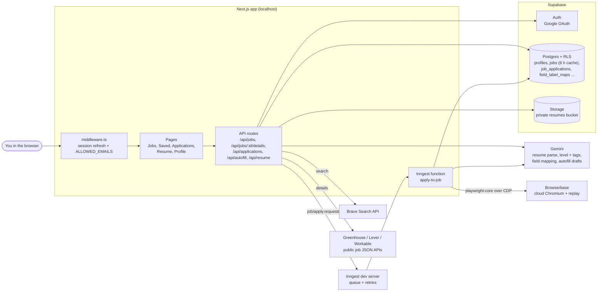

# Architecture

Truffle Pig is one Next.js 15 app (App Router) that runs on `localhost` for one person. State lives in Supabase.
Slow work (driving a browser) runs in an Inngest function, not inside a web request.

## Request paths

**Search** (`app/api/jobs/route.ts`). The role comes from the search box or the profile headline. The place comes
from the profile location, reduced to a city by `buildSearchPlace`. `getJobs` (`lib/jobs.ts`) returns cached rows
younger than 6 hours, and otherwise asks Brave once per source with a bare domain filter (`lib/brave.ts`). Match %
is computed per user at read time (`lib/match.ts`), so the cache is shared. SEEK and Jora links are built, not
fetched (`lib/job-boards.ts`).

**Details** (`app/api/jobs/[id]/details/route.ts`). The first time a job is opened, `fetchJobDetails`
(`lib/job-details.ts`) calls the ATS's public JSON API, then asks Gemini for level and tags with a 15 s timeout.
The result is written to the shared `jobs` row, so the next person who opens it pays nothing. A 404 from the ATS
answers 410 (job closed).

**Apply** (`app/api/applications/route.ts`). Only ATS sources can be queued. The route inserts a `queued` row
and sends `job/apply.requested` to Inngest. The function (`lib/inngest/functions.ts`) and its statuses are
described in [robot-pipeline.md](robot-pipeline.md).

## Security model

- **Single user.** `ALLOWED_EMAILS` is checked in the OAuth callback, in middleware for `/dashboard`, and in
  `getApiUser` for every API route (`lib/allowed-emails.ts`). An empty list lets nobody in.
- **Row Level Security** on every user table (`supabase/schema.sql`): users read and write only their own rows.
  The shared tables (`jobs`, `field_label_maps`) are written only by server code with the secret key
  (`lib/supabase/admin.ts`, marked `server-only`).
- **Secrets stay on the server.** Only the Supabase URL and publishable key use the `NEXT_PUBLIC_` prefix.
- **Resumes** sit in a private Storage bucket. The robot downloads the file server-side to upload it to a form.
