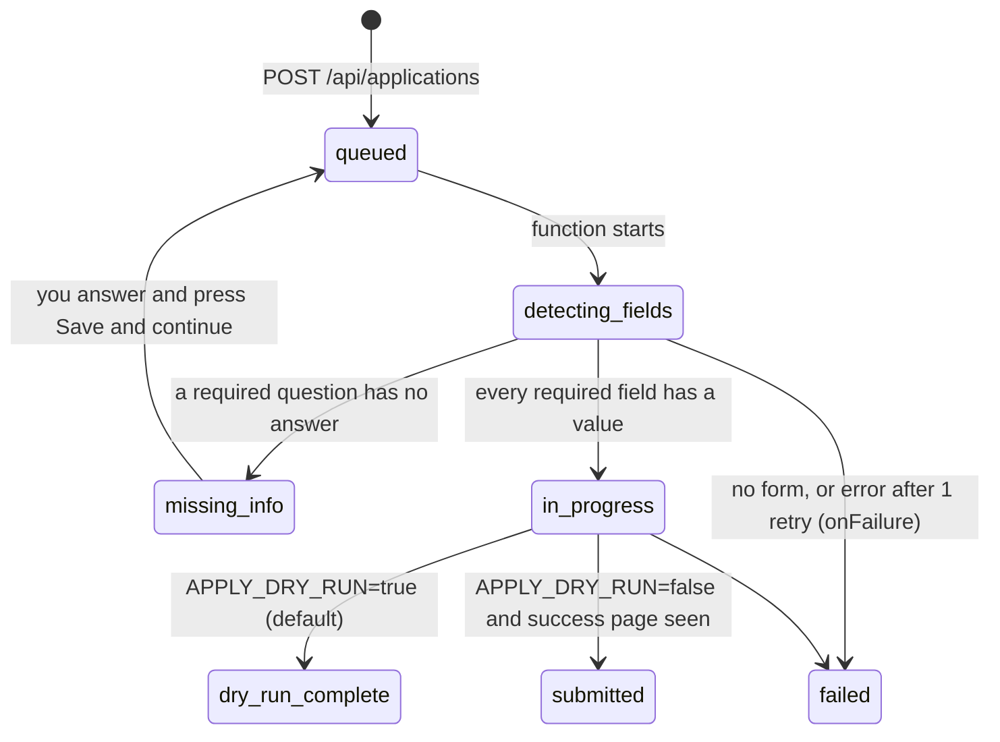

# The apply robot

The robot fills in application forms on company careers pages (Greenhouse, Lever, Workable). It runs as one
Inngest function, `apply-to-job` in [`lib/inngest/functions.ts`](../lib/inngest/functions.ts), driving a cloud
Chromium on Browserbase with `playwright-core`.

## Statuses

The Applications page polls every 4 s while anything is `queued`, `detecting_fields` or `in_progress`, and shows
each row as a five-stage track.

## Steps

Each step is an Inngest `step.run`, so a retry resumes after the last step that succeeded.

1. **load-application.** Read the application, the profile and the newest resume. Missing data is a
   `NonRetriableError`.
2. **detect-fields** ([`lib/apply/detect.ts`](../lib/apply/detect.ts)). Open the apply URL in a new Browserbase
   session, wait for a form with an email box, and read every input, select and textarea inside the browser:
   its question text, type, required flag and options. Radio and checkbox groups become one question. Lever keeps
   the question in `.application-label`, so that is read first.
3. **map-fields** ([`lib/apply/map.ts`](../lib/apply/map.ts)). Find a value for each field, cheapest source first:
   1. answers you already gave, for this application or any earlier one (`profiles.extra_answers`, matched by
      normalised label);
   2. `field_label_maps`: labels seen before on the same platform, mapped to a profile fact such as `phone` or
      `linkedin_url`. No model call;
   3. one Gemini call for the rest, told to use only profile facts and to return `null` when unsure. When a
      returned value equals a profile fact exactly, the label is saved to `field_label_maps` for next time.
4. **mark-missing-info** if any required field is still empty. The run ends here. You answer in the dialog (with
   optional AI Autofill drafts), and saving queues a new run with your answers.
5. **fill-and-submit** ([`lib/apply/fill.ts`](../lib/apply/fill.ts)). Open a fresh session, download the resume from
   the private bucket, fill each field, and upload the file. Fields that fail are retried once with Stagehand
   `act()` in the same session ([`lib/apply/stagehand.ts`](../lib/apply/stagehand.ts)); values are passed as
   variables so they are not sent to the model. In dry run it stops before Submit. Otherwise it clicks Submit and
   only reports `submitted` if the page shows a confirmation.
6. **mark-done** and an activity log entry.

At most 2 runs execute at once (`concurrency: { limit: 2 }`).

## Known limits

- **Custom dropdowns.** New Greenhouse boards (`job-boards.greenhouse.io`) render React selects, not `<select>`.
  They are detected as `text` without options, so the robot types the answer and relies on the Stagehand
  fallback.
- **Not every Lever link has a form.** Some postings redirect elsewhere; the run then fails with
  "Could not find an application form on this page".
- **Two sessions per run.** Detect and fill use separate Browserbase sessions. The detect replay is static; the
  Replay button points at the latest session.
- **Login-only boards are out of scope.** LinkedIn, SEEK and Jora need your own account, so the API refuses to
  queue them (`canAutoApply` in [`lib/types.ts`](../lib/types.ts)).
